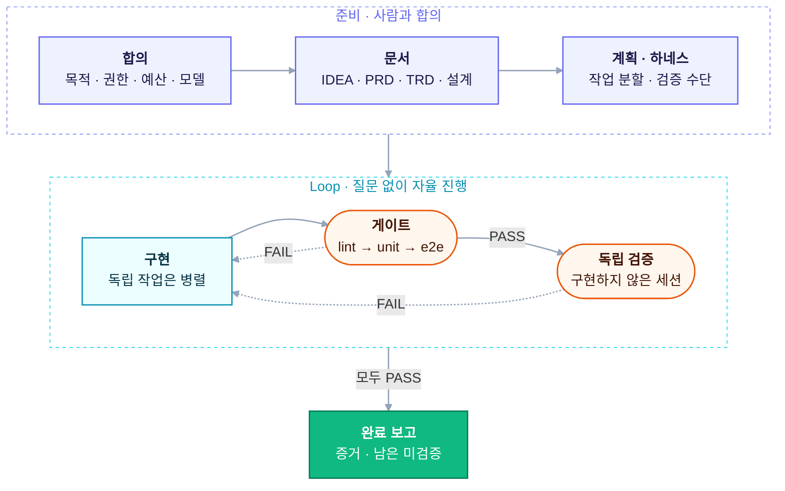

# harness-loop-fullstack-kor

**요구 구체화부터 구현·검증·복구까지, 처음에 합의한 범위 안에서 에이전트가 끝까지 진행하는 한국어 스킬 플러그인**

*Korean agent skills for Claude Code & Codex — idea → PRD → architecture → plan → verification harness → autonomous loop.* ([English](README.en.md))

[](CHANGELOG.md)
[](LICENSE)
[](#설치)
[](docs/getting-started.md#codex)

---

## 무엇을 해 주나

"이런 앱을 만들고 싶어"에서 출발해 요구·기술·설계 문서를 정리하고, 작업을 나누고, 검증 기준을 세운 뒤
**그 기준을 실제로 통과할 때까지 구현·검증·복구를 스스로 이어 갑니다.**
사람은 IDEA·PRD·TRD를 에이전트와 대화로 정하고, 시작 전에 목적·권한·예산을 정하며, 화면 제품이면 디자인을 고릅니다. Loop가 시작되면 질문 없이 끝까지 갑니다.



- **완료는 증거로 판정합니다.** `lint → unit → e2e → task_validation` 순서로 판정하고, 마지막 판정은 그 코드를 만들지 않은 별도 세션이 실제로 실행해 내립니다.
- **질문은 Loop 전에 합니다.** IDEA·PRD·TRD는 대화로 정합니다. 내용을 구체적이고 사용자에게 맞게 만들도록 선택지·이유·추천안을 붙여 필요한 만큼 묻고, 문서마다 요약과 가정을 보여 드리고 검토를 받습니다. 목적·권한·예산·금지 사항, 쓸 모델과 사용량 한도에 걸렸을 때의 처리도 Loop 전에 정합니다.
- **막히면 사람을 기다리지 않고 전략을 바꿉니다.** 같은 방식의 수정이 3번 안에 풀리지 않으면 원인을 다시 분석해 다른 방법을 씁니다. 끝내 안 되면 변경과 증거를 남기고 미완료로 정직하게 보고합니다.
- **독립 작업은 병렬로 합니다.** 워커 수는 작업의 독립성과 자원을 보고 에이전트가 정합니다. [Orca](docs/loop.md#orca에서-병렬로-돌리기)가 있으면 워크트리 워커로 나눠 돌립니다.
- **완료 뒤에도 이어집니다.** 기능 추가·버그 수정·리팩토링, 문서 없는 기존 코드를 이 흐름에 올리는 스킬이 있습니다.

## 2.0에서 달라진 점

1.x는 실제 프로젝트에 적용하면서 문제가 생길 때마다 규칙과 예외 처리를 더해 다듬었습니다. 규칙이 쌓일수록 지시문은 길어졌고, 에이전트는 절차를 따르는 데 집중하느라 오히려 상황 판단이 줄었습니다.

2.0은 최근의 에이전트 스킬·프롬프트 작성 권고에 맞춰 다시 썼습니다. 지시는 짧게 쓰고, 목적과 반드시 지킬 제약만 분명히 하고, 방법은 모델에 맡기는 방식입니다. 그래서 **큰 흐름과 꼭 지킬 것만 정하고, 나머지는 에이전트가 프로젝트에 맞게 판단합니다.** 꼭 지킬 것은 검증 순서, 구현과 분리된 검증, 시작 전 합의입니다.

| | 1.x (1.15.5) | 2.0 |
|---|---|---|
| 스킬 지시문 분량 | 9,699줄 | 1,603줄 (약 83% 감소) |
| 진행 방식 | 단계마다 검토, 루프 중 질문은 답할 때까지 대기 | Loop 실행 전까지 단계마다 결과 보고·진행 확인, Loop 후 질문 없음 |
| 실패 처리 | 3회 실패하면 멈추고 사람에게 질문 | 3회 안에 원인 분석·새 전략, 끝내 막히면 정직한 미완료 |
| 실행 구조 | 프로젝트마다 구동·감시 스크립트 생성 | Claude Code·Codex·Orca 기능을 그대로 사용 |
| 화면 디자인 | 정해진 자리 없음 | 구현 전에 실제 미리보기를 보고 사용자가 선택 |

같은 과제로 비교했을 때 2.0은 1.x보다 빨리 끝났고 토큰도 크게 덜 썼습니다. 자세한 내용은 [변경 기록](CHANGELOG.md#200)에 있습니다.

에이전트 개발 환경과 모델은 빠르게 바뀝니다. 이 플러그인도 모델과 호스트(Claude Code·Codex·Orca)의 변화에 맞춰 계속 업데이트할 예정입니다. 모델이 좋아질수록 지시는 더 줄이고 자율은 더 넓히는 방향입니다.

## 설치

```text
# Claude Code
/plugin marketplace add GangJaeYu/harness_loop_full_korean
/plugin install harness-loop-fullstack-kor@harness-loop-fullstack-kor
```

```bash
# Codex
codex plugin marketplace add GangJaeYu/harness_loop_full_korean
codex plugin add harness-loop-fullstack-kor@harness-loop-fullstack-kor
```

버전을 고정하려면 `GangJaeYu/harness_loop_full_korean@v2.2.2`처럼 붙입니다.
**1.x(`harness-loop-fullstack`)를 쓰고 있었다면** 2.0에서 플러그인 이름이 바뀌었으니 [시작하기](docs/getting-started.md#1x에서-옮기기)를 따라 바꿔 설치하세요.

**필요한 것:** git, Claude Code 또는 Codex CLI. 나머지 도구(Docker, 브라우저 테스트, WSL, Orca 등)는 프로젝트에 필요할 때 에이전트가 확인하고, 없으면 Loop 전에 알려 줍니다.

## 빠르게 시작하기

```text
이런 앱을 만들고 싶어: (설명). 환경을 확인하고 필요한 것을 먼저 물은 뒤 구현과 검증까지 진행해줘.
```

- Loop 실행 전까지 단계마다 **결과를 보고받고 이어 진행할지 답하는** 방식입니다.
- 확인을 건너뛰려면 "단계별 확인 없이 루프까지 진행해"처럼 직접 말해야 합니다. "끝까지 만들어줘"나 권한·예산 합의만으로는 건너뛰지 않습니다.
- 원하는 단계가 분명하면 **스킬 이름을 직접 부르는 것이 가장 확실합니다.**

```text
/harness-loop-fullstack-kor:prd-generator 이 아이디어로 PRD 써줘      # Claude Code
$bug-fix 검색에서 소문자로 찾으면 결과가 빠져                          # Codex
```

## 스킬 한눈에

| 이럴 때 | 스킬 | 만들어지는 것 |
|---|---|---|
| 아이디어가 아직 막연하다 | `idea-brainstorm` | `docs/IDEA.md` |
| 요구와 완료 기준을 정한다(화면이면 디자인 선택까지) | `prd-generator` | `docs/PRD.md`, 디자인 정본 |
| 기술을 정한다 | `trd-generator` | `docs/TRD.md` |
| 구조와 흐름을 설계한다 | `architecture-generator` | `docs/ARCHITECTURE/` |
| 작업을 나눈다 | `plan-generator` | `plan_setup/` |
| 검증 수단과 로컬 환경을 준비·갱신한다 | `harness-setup` · `harness-update` | `harness_setup/` |
| 자율 실행을 준비·조정한다 | `loop-setup` · `loop-update` | `loop_setup/LOOP.md` |
| 문서 없는 코드를 정리한다 | `code-to-docs` | 현재 코드 기준 문서 |
| 기능을 추가한다 / 버그를 고친다 / 리팩토링한다 | `feature-add` · `bug-fix` · `refactor-plan` | 영향 범위의 문서·계획·수정·검증 |

자세한 설명은 [스킬 안내](docs/skills.md)에 있습니다.

## 알아 둘 점

- **작은 일에는 가볍게 씁니다.** 문서만 원하거나 작은 수정이면 전체 흐름을 강제하지 않습니다. 다만 Loop로 완성까지 가는 일은 단일 프롬프트보다 시간과 토큰이 더 듭니다. 검증을 실제로 돌리기 때문입니다.
- **부모(조정) 세션이 끊기면 멈춥니다.** 자동으로 되살리지 않습니다. 다시 부르면 기록과 실제 상태를 확인해 이어 갑니다.
- **Orca로 띄운 Claude 워커는 권한 확인 없이 실행됩니다.** Orca의 동작 방식입니다. 허용 범위는 Loop 전 합의에 분명히 적어 두세요.
- Claude Code와 Codex 양쪽에서 아이디어부터 Loop 완료까지의 흐름을 확인했습니다. 화면·DB가 있는 큰 제품의 장시간 Loop는 아직 사례가 적습니다.

## 문서

| 문서 | 내용 |
|---|---|
| [시작하기](docs/getting-started.md) | 설치, 1.x에서 옮기기, 플러그인 없이 쓰기, 첫 프로젝트 |
| [스킬 안내](docs/skills.md) | 스킬 13개의 용도·산출물·다음 단계 |
| [진행 방식](docs/workflow.md) | 합의, 단계 확인, 디자인 선택, 문서가 바뀔 때 |
| [검증 하네스](docs/harness.md) | 네 게이트, 독립 검증, 다른 OS 검증 |
| [개발 루프](docs/loop.md) | 병렬과 Orca, 실패와 전략 전환, 중단과 재개, 모델과 한도 |
| [변경 기록](CHANGELOG.md) | 버전별 변경 |

## 라이선스

MIT
